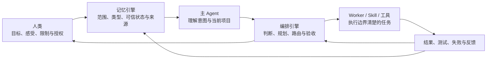

# 双引擎成长蓝图

> 一条项目主线、两台协作引擎、三道长期护栏、四期演进路线。

本蓝图描述 `agent-project-playbook` 如何从一期协作章程，持续演进为一套可迁移、
可验证、由人类治理的人机项目协作系统。它是方向与边界，不是对尚未实现能力的声明。

当前 `v0.4.0` 已完成 Phase I 的协议、模板、测试守卫和 Codex 适配验证；
Phase II–IV 是后续路线，必须逐期实现、验证和发布。

## 1. 核心命题

模型能力决定系统这一刻有多聪明；记忆深度决定系统能否积累；编排质量决定积累能否
转化成行动；治理协议决定系统成长后是否仍然可靠。

本项目因此不把记忆理解为聊天记录仓库，也不把编排理解为多 Agent 数量。它们共同组成
一个双引擎成长飞轮：



闭环可以压缩为：

```text
理解 → 编排 → 执行 → 验证 → 记忆 → 更好的理解
```

没有编排的记忆只会保留信息，却不能形成行动；没有记忆的编排可以行动，却会重复理解、
重复调查和重犯旧错。

## 2. 一条项目主线

双引擎服务于同一条项目主线，不取代项目本身：

```text
模糊想法
→ 探索
→ 启动
→ 实施
→ 最小垂直切片
→ 验证与交付
→ 新认识进入下一轮
```

Design Thinking 帮助项目从模糊走向清晰；探索、启动、实施决定本轮如何协作；
问题单、垂直切片和验收证据保证项目逐步收敛。

## 3. 记忆引擎：认知平面

记忆引擎回答四个问题：

1. 这条信息属于当前任务、当前项目还是全局协作？
2. 它是工作、语义、情景还是程序记忆？
3. 它是候选、已验证、待复核还是已废弃？
4. 它的来源和当前验证证据是什么？

### 三级记忆

| 层级 | 主要内容 | 生命周期 | 默认边界 |
| --- | --- | --- | --- |
| 任务记忆 | 本轮目标、临时假设、计划和进度 | 一次任务 | 不自动长期保存 |
| 项目记忆 | 项目事实、架构、决定、失败与修复 | 整个项目 | 仅属于当前项目 |
| 全局记忆 | 稳定的个人协作偏好、通用流程和跨项目经验 | 跨项目、跨模型 | 必须明确确认后晋升 |

项目记忆本身已经是项目范围内的长期记忆。全局记忆只是作用范围更大，不代表权威更高；
进入具体项目后，当前用户指令、代码、测试、配置和真实输出始终优先。

### 跨层晋升

```text
任务结果
→ 项目候选记忆
→ 当前证据验证
→ 项目已验证记忆
→ 多项目重复验证
→ 全局候选
→ 人工确认
→ 全局记忆
```

一次成功或失败不能自动成为全局规则。跨层晋升必须保留来源、可信状态和人工确认，
避免单个项目污染其他项目。

## 4. 编排引擎：控制平面

编排引擎不追求更多 Agent，而是减少用户亲自协调的工作，同时提高执行可靠性。
它由五个逻辑模块组成：

| 模块 | 负责什么 |
| --- | --- |
| 阶段判断器 | 判断协作模式、项目阶段和本轮最需要的交付物 |
| 交付规划器 | 形成问题单、验收标准、最小垂直切片和依赖关系 |
| 能力路由器 | 先判断是否值得委派，再按难度、风险、权限和验证难度选择执行配置 |
| 持久执行器 | 管理并行、检查点、暂停、恢复、重试、幂等和人工授权门 |
| 证据裁判器 | 汇总代码、测试、文档和运行结果，处理冲突并统一验收 |

一期采用 Manager Pattern / Orchestrator–Worker：用户只与主 Agent 沟通，主 Agent
负责分发、回收、审查和最终交付。未来的持久任务图和自动路由仍然服从这一责任结构，
不会把管理多个 Agent 的负担转移给用户。

## 5. 两台引擎的交换契约

| 流向 | 交换内容 | 禁止行为 |
| --- | --- | --- |
| 记忆 → 编排 | 已验证偏好、项目事实、历史决定、已知失败和风险 | 用待复核记忆覆盖当前证据 |
| 编排 → 记忆 | 问题单、尝试、测试结果、修复证据、决定与新风险 | 把全部过程和原始聊天永久保存 |
| 人类 → 双引擎 | 目标、价值判断、边界、反馈和高风险授权 | 把沉默解释成授权 |
| 双引擎 → 人类 | 一个统一结果、验证证据、风险和具体下一步 | 用后台复杂度要求用户亲自调度 |

记忆引擎让主 Agent 更好地理解意图，编排引擎让每次执行产生更高质量、可验证的记忆；
这就是成长飞轮的最小闭环。

## 6. 四道长期护栏

### 当前证据高于历史记忆

记忆只提供线索和上下文。当前用户指令、代码、测试、配置和真实运行结果可以推翻旧记忆。

### 项目隔离与显式晋升

项目状态、凭据、失败经验和实现约定不跨项目自动继承。只有经过重复验证并由用户确认的
通用规则，才能进入全局。

### 运行隔离与发布治理

开发、测试、预发布和生产的状态、凭据与写权限保持隔离；`main` 不等于生产。正式发布
必须经过明确授权、固定 release、健康检查和已知回滚目标。

### 人类最终授权

高风险外部写入、部署、删除、凭据操作、全局记忆晋升和永久规则变化必须保留人类授权。
系统可以提出候选和建议，不能自行扩大权限。

## 7. 四期演进路线

| 阶段 | 记忆引擎 | 编排引擎 | 用户体验 | 状态 |
| --- | --- | --- | --- | --- |
| Phase I：结构化 | 范围、类型、可信状态、载体分工和项目隔离 | Manager 模式、委派价值闸、执行配置、垂直切片和主 Agent 验收 | 只需要与主 Agent 保持一条对话线 | 当前已实现 |
| Phase II：可检索、可路由 | 有界冷热记忆、全文与向量混合检索、来源和可信度过滤 | 机器可读问题单与能力目录；记录委派、模型、成本、质量和失败证据 | 更快恢复上下文，更准确选择能力 | 下一阶段 |
| Phase III：可关联、可续跑 | 记忆原子、类型化关系、冲突链、来源链和过期管理 | 持久任务图、检查点、暂停恢复、超时回收、失败重规划和幂等执行 | 长任务跨会话继续，不重复成功步骤 | 规划阶段 |
| Phase IV：可学习、受治理 | 聚类、去重、陈旧检测和 Dream 式候选整理 | 基于评估结果改进路由建议、模型选择和验收策略 | 合作越久越省心，但不会擅自越权 | 远期方向 |

Phase II 的混合检索、Phase III 的持久任务图和 Phase IV 的 Dream 整理均须先确认原生能力和既有载体无法满足的具体缺口，再评估最小适配。向量检索仍须遵守作用范围、可信状态和证据要求。
Phase IV 的“学习”只产生候选策略；没有评估证据和人类确认，不自动修改全局规则。

## 8. 抵抗模型变迁

本系统把可替换能力与长期资产分开：

| 可替换层 | 长期保留层 |
| --- | --- |
| 主模型与 Worker 模型 | 分层记忆及其来源、范围和可信状态 |
| Agent 平台和运行时 | 项目主线、问题单、垂直切片和授权规则 |
| Skill、工具和检索实现 | 当前代码、测试、文档与运行证据 |
| 向量库、图数据库和存储产品 | 开放、可检查、可迁移的语义与事件记录 |

模型可以替换，工具可以淘汰，运行时可以迁移。只要关键记忆、协作协议和验证证据不被
锁在某个模型的黑盒中，新模型就能恢复合作方式与项目脉络，而不必从零认识用户和项目。

这不保证不同模型具有相同能力，但能保留系统的连续性、治理边界和已积累经验。

## 9. 自生长的准确边界

本蓝图追求的是 **Human-Governed Evolution / 人类治理下的持续演化**，不是无限自治。

系统未来可以自动发现重复模式、提出候选记忆、推荐路由策略、识别陈旧信息并收集评估
证据；但它不能自动把候选晋升为永久真理、跨项目传播私有内容、扩大工具权限或绕过
高风险确认。

每一次演进都必须回答：

1. 它解决了什么可观察的协作问题？
2. 它属于记忆、编排还是两者之间的契约？
3. 如何验证它确实提高了恢复、路由、执行或验收质量？
4. 失败时怎样降级，怎样回到单 Agent 和当前证据？
5. 它是否保持项目隔离、可迁移和人类最终授权？

## 10. 理论与实现参考

- [CoALA：语言 Agent 的认知架构](https://arxiv.org/abs/2309.02427)
- [Anthropic：Orchestrator–Worker 多 Agent 研究系统](https://www.anthropic.com/engineering/multi-agent-research-system)
- [Anthropic：Contextual Retrieval](https://www.anthropic.com/engineering/contextual-retrieval)
- [Anthropic：长期 Agent 的增量进展与交接](https://www.anthropic.com/engineering/effective-harnesses-for-long-running-agents)
- [Anthropic：解耦 brain、hands 与 session](https://www.anthropic.com/engineering/managed-agents)
- [LangGraph：持久化、检查点与恢复](https://docs.langchain.com/oss/python/langgraph/persistence)

这些材料提供认知架构、检索、编排和持久执行参考；本项目的独特层位仍然是把项目阶段
判断、记忆治理、人机协作纪律和可安装章程组合成位于具体运行时之上的方法论层。
